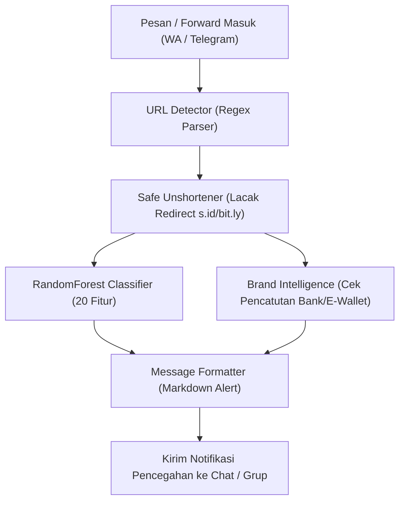

# Panduan Integrasi PhishGuard ke WhatsApp & Telegram (Sistem Pencegahan Phishing)

Dokumentasi ini menjelaskan implementasi dan cara menjalankan integrasi **PhishGuard** ke aplikasi pesan instan (**WhatsApp** dan **Telegram**) sebagai garda terdepan pencegahan penipuan siber (*early threat prevention*).

---

## 1. Arsitektur Pencegahan Penipuan Berbasis Chat

Sebagian besar serangan phishing di Indonesia menyebar melalui pesan siaran (*broadcast message*) di grup WhatsApp atau obrolan Telegram (seperti modus bansos, undian berhadiah, APK bodong, link DANA Kaget, atau phishing perbankan).

Dengan integrasi ini:
1. **Ekstraksi Otomatis:** Sistem mendeteksi dan mengekstrak tautan web dari teks pesan atau pesan yang diteruskan (*forwarded message*).
2. **Analisis Instan (<25 ms):** Tautan dipindai langsung oleh mesin *Random Forest* lokal, diperiksa keaslian mereknya (*Brand Intelligence*), dan dilacak jika menggunakan pemendek link (*Safe Unshortener*).
3. **Respon Ramah Pengguna:** Bot membalas dengan status warna, tingkat risiko, dan **rekomendasi tindakan preventif** (jangan klik, jangan berikan OTP, segera blokir pengirim).



---

## 2. Integrasi Telegram Bot (Siap Pakai & Sangat Mudah)

Telegram menyediakan Bot API resmi yang 100% gratis dan dapat langsung dijalankan di komputer lokal tanpa memerlukan IP publik atau domain.

### Langkah-Langkah Menjalankan Bot Telegram:

1. **Buat Bot di Telegram:**
   * Buka aplikasi Telegram, cari akun resmi **`@BotFather`**.
   * Kirim perintah `/newbot`.
   * Masukkan nama bot (misal: `PhishGuard Anti-Phishing`).
   * Masukkan username bot (misal: `phishguard_detector_bot`).
   * `@BotFather` akan memberikan **HTTP API Token** (contoh: `7123456789:ABCdefGhIjkLmNoPqRsTuVwXyZ`).

2. **Jalankan Bot di Komputer Lokal:**
   Jalankan perintah berikut di terminal:
   ```powershell
   python run_telegram_bot.py --token <TOKEN_DARI_BOTFATHER>
   ```
   *Atau simpan token di file `.env`:*
   ```env
   TELEGRAM_BOT_TOKEN=7123456789:ABCdefGhIjkLmNoPqRsTuVwXyZ
   ```
   Lalu cukup jalankan:
   ```powershell
   python run_telegram_bot.py
   ```

3. **Uji Coba di Telegram:**
   * Buka bot Anda di Telegram dan klik **/start**.
   * Kirimkan pesan atau forward link mencurigakan (misal: `http://dana-kaget-bansos-bri.xyz/login`).
   * Bot akan langsung membalas dengan kartu peringatan merah, alasan ancaman, dan langkah pencegahan.

---

## 3. Integrasi WhatsApp (FastAPI Webhook)

Untuk WhatsApp, PhishGuard menyediakan endpoint webhook resmi di backend FastAPI:
* **URL Endpoint:** `POST /api/webhook/whatsapp`
* **Verifikasi Handshake:** `GET /api/webhook/whatsapp`

Endpoint ini mendukung dua ekosistem:
1. **Meta WhatsApp Cloud API (Graph API Resmi):** Untuk akun WhatsApp Business resmi.
2. **Gateway Lokal Indonesia (Fonnte / Wablas / Baileys):** Sangat populer untuk prototipe kampus, demo lomba, dan tugas besar karena mudah dipasang dengan nomor WhatsApp pribadi/komersial biasa.

### Menggunakan Fonnte (Rekomendasi Cepat untuk Demo Kuliah):
1. Daftar gratis di [Fonnte.com](https://fonnte.com/) dan tautkan nomor WhatsApp Anda melalui scan QR Code.
2. Masukkan URL Webhook PhishGuard di dashboard Fonnte:
   `https://<domain-anda>/api/webhook/whatsapp` *(bisa menggunakan Cloudflare Tunnel / Ngrok saat pengujian lokal)*.
3. Simpan token Fonnte di `.env`:
   ```env
   FONNTE_API_TOKEN=token_fonnte_anda
   ```
4. Setiap ada pesan masuk ke WhatsApp yang memuat link, PhishGuard akan membalas otomatis dengan format pesan peringatan WhatsApp (*bold*, _italic_, ```mono```).

---

## 4. Contoh Format Peringatan yang Diterima Pengguna

### Contoh Tautan Phishing:
```text
🚨 [PERINGATAN BAHAYA: LINK PHISHING] 🚨

⚠️ JANGAN KLIK LINK INI! Terdeteksi indikasi kejahatan penipuan siber / pencurian data akun & rekening.

🔗 Target URL: http://dana-kaget-bansos-bri.xyz/login
📊 Tingkat Risiko: 100.0% (BAHAYA)

🏦 Indikasi Pencatutan Brand:
Tautan ini meniru merek PT Bank Rakyat Indonesia (BRI), padahal BUKAN domain resmi milik instansi tersebut!

📌 Temuan Keamanan:
- Menggunakan domain berisiko tinggi (.xyz/.top/dsb).
- Memuat kata pancingan penipuan (bansos, dana, login).

🛡️ Langkah Pencegahan:
1. 🚫 Jangan klik tautan ini.
2. 🔒 Jangan berikan password, PIN, atau kode OTP kepada siapapun.
3. 📵 Hapus pesan dan blokir nomor WhatsApp pengirim.

🛡️ PhishGuard Cyber Threat Intelligence
```

### Contoh Tautan Aman:
```text
✅ [STATUS: LINK AMAN] ✅

🔗 Target URL: https://detik.com/berita/pemilu-2026
📊 Tingkat Risiko: 1.0% (Aman)

📌 Keterangan: Tautan bebas dari pola manipulasi kredensial dan tidak berbahaya.

🛡️ PhishGuard Cyber Threat Intelligence
```
