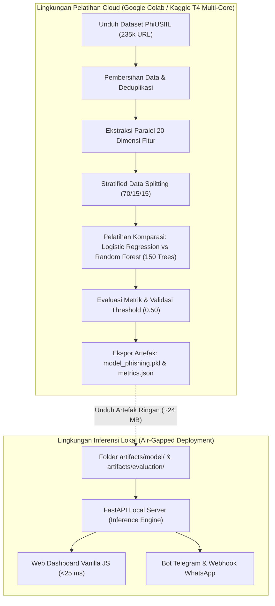

# LAPORAN TUGAS AKHIR SEMESTER (UAS)
## MATA KULIAH: KEAMANAN INFORMASI (KP70065004)
### PROGRAM STUDI INFORMATIKA — FAKULTAS TEKNIK — UNIVERSITAS SILIWANGI

---

# PENGEMBANGAN SISTEM DETEKSI DAN PENCEGAHAN URL PHISHING BERBASIS MACHINE LEARNING DENGAN ARSITEKTUR AIR-GAPPED INFERENCE

**Dosen Pengampu:**  
Muhammad Sidik Asyaky, S.T., M.T.

**Disusun Oleh (Kelompok Kelas E):**
1. **Ripki Maulana** (NIM: 247006111139) — *Machine Learning Engineer*
2. **Muhammad Fachri** (NIM: 247006111140) — *Backend & Security Developer*
3. **Omar** (NIM: 247006111164) — *Frontend & Integration Developer*

* **Topik Proyek:** Topik 1 — Defensive AI (*Detektor Phishing URL Berbasis Machine Learning*)
* **Repositori:** `phish-guard`
* **Semester:** Ganjil 2026/2027
* **Tanggal:** November 2026

---

## DAFTAR ISI
1. [BAB I: PENDAHULUAN](#bab-i-pendahuluan)
   - 1.1 Latar Belakang
   - 1.2 Rumusan Masalah
   - 1.3 Batasan Masalah
   - 1.4 Tujuan Proyek
   - 1.5 Manfaat Proyek
2. [BAB II: LANDASAN TEORI & TINJAUAN PUSTAKA](#bab-ii-landasan-teori--tinjauan-pustaka)
   - 2.1 Anatomi Serangan Phishing Berbasis URL
   - 2.2 Domain Generation Algorithms (DGA) & Teori Entropi Shannon
   - 2.3 Internationalized Domain Name (IDN) Homograph Attack
   - 2.4 Pembelajaran Mesin: Logistic Regression vs Random Forest
   - 2.5 Prinsip Air-Gapped Network-Free Feature Extraction
3. [BAB III: METODOLOGI PENELITIAN & PERANCANGAN SISTEM](#bab-iii-metodologi-penelitian--perancangan-sistem)
   - 3.1 Dataset dan Atribusi Lisensi
   - 3.2 Pembersihan Data dan Strategi Partisi (Data Splitting)
   - 3.3 Rekayasa Fitur (20 Golden Feature Dimensions)
   - 3.4 Arsitektur Pelatihan Cloud-to-Local MLOps
   - 3.5 Perancangan Backend API, Hardening Keamanan, dan Frontend
   - 3.6 Modul Investigasi Forensik dan Integrasi Chatbot (Telegram & WhatsApp)
4. [BAB IV: HASIL DAN PEMBAHASAN](#bab-iv-hasil-dan-pembahasan)
   - 4.1 Evaluasi Kinerja Model pada Test Set
   - 4.2 Analisis Matriks Konfusi (Confusion Matrix)
   - 4.3 Analisis Kontribusi Fitur (Feature Importance Ranking)
   - 4.4 Analisis False Positive dan False Negative
   - 4.5 Analisis Ketahanan Terhadap Evasion Attack & Concept Drift
   - 4.6 Pengujian Unit dan Integrasi Sistem
5. [BAB V: KESIMPULAN DAN SARAN](#bab-v-kesimpulan-dan-saran)
   - 5.1 Kesimpulan
   - 5.2 Keterbatasan Sistem
   - 5.3 Saran Pengembangan
6. [DAFTAR PUSTAKA](#daftar-pustaka)

---

## BAB I: PENDAHULUAN

### 1.1 Latar Belakang
Perkembangan lanskap kejahatan siber (*cybercrime*) dalam beberapa tahun terakhir menunjukkan peningkatan eskalasi serangan rekayasa sosial (*social engineering*), khususnya melalui media phishing. Berdasarkan laporan *Anti-Phishing Working Group* (APWG) dan Badan Siber dan Sandi Negara (BSSN), phishing berbasis *Uniform Resource Locator* (URL) tetap menjadi vektor infeksi dan pencurian kredensial nomor satu di dunia dan Indonesia. Modus operandi yang marak terjadi mencakup penyebaran tautan palsu perbankan, manipulasi program bantuan sosial pemerintah (Bansos/BLT), pembagian saldo dompet digital palsu (seperti "DANA Kaget"), hingga pencatutan identitas institusi resmi.

Metode deteksi konvensional umumnya mengandalkan pendekatan *Blacklist* / *Blocklist* (seperti Google Safe Browsing atau DNS Filtering). Meskipun akurat untuk ancaman yang sudah terdata, metode berbasis *blacklist* memiliki kelemahan fundamental berupa latensi pembaruan (*update lag*) dan ketidakmampuan mendeteksi ancaman *zero-day phishing*. Pelaku kejahatan siber secara aktif memanfaatkan *disposable domain*, pemendek tautan (*URL shortener*), serta teknik *fast-flux hosting* di mana rata-rata masa hidup (*lifespan*) domain phishing kini kurang dari 4 hingga 8 jam.

Untuk mengatasi kelemahan tersebut, pendekatan berbasis *Machine Learning* (ML) menjadi solusi mutakhir karena mampu mengevaluasi pola struktural, sintaksis, dan leksikal dari sebuah URL secara prediktif. Namun, mayoritas sistem deteksi berbasis ML yang ada saat ini memerlukan perayapan konten web (*crawling/scraping* HTML, DOM analysis, atau rendering tangkapan layar visual). Pendekatan perayapan konten memiliki tiga risiko keamanan dan operasional yang kritis:
1. **Risiko Keamanan Sistem (*Zero-Day Exploitation*):** Mengunjungi URL mencurigakan membuka celah *drive-by download*, eksploitasi browser (*remote code execution*), dan serangan *Server-Side Request Forgery* (SSRF) pada mesin pemindai.
2. **Latensi Komputasi Tinggi:** Mengunduh aset web membutuhkan waktu ratusan milidetik hingga beberapa detik, tidak layak untuk implementasi berkecepatan tinggi (*line-rate filtering*).
3. **Mekanisme Evasion Pelaku:** Server penyerang sering kali menerapkan *cloaking* atau *conditional rendering* (hanya menampilkan halaman phishing jika dibuka dari perangkat mobile atau user-agent tertentu, sedangkan perayap bot diarahkan ke halaman kosong).

Berdasarkan permasalahan tersebut, proyek **PhishGuard** dikembangkan sebagai sistem deteksi URL phishing berbasis pembelajaran mesin deterministik dengan filosofi **Air-Gapped & Network-Free Inference**. PhishGuard hanya menganalisis representasi string teks dari URL mentah tanpa pernah membuka koneksi soket, melakukan resolusi DNS, ataupun mengunduh muatan halaman web target pada pipeline deteksi utamanya.

---

### 1.2 Rumusan Masalah
1. Bagaimana mentransformasikan string URL mentah (*raw URL*) menjadi representasi vektor numerik berdimensi tinggi secara konsisten, deterministik, dan bebas dari ketergantungan koneksi jaringan (*network-free*)?
2. Bagaimana perbandingan performa empiris antara model parametrik linier (*Logistic Regression*) dan model ensemble non-linier (*Random Forest Classifier*) dalam mengklasifikasikan URL phishing pada dataset skala besar berstandar internasional?
3. Bagaimana merancang arsitektur sistem deteksi yang aman, berlatensi ultra-rendah (<30 ms), dilengkapi mitigasi *false positive* berbasis *brand intelligence*, serta terintegrasi langsung dengan saluran komunikasi publik (Telegram dan WhatsApp) sebagai garda terdepan pencegahan penipuan?

---

### 1.3 Batasan Masalah
1. Analisis klasifikasi inti model PhishGuard berfokus murni pada karakteristik string teks URL (*lexical, syntactic, statistical entropy, and structural features*).
2. Investigasi jaringan mendalam (*DNS lookup*, *TLS Certificate check*, dan *Server Geolocation*) diisolasi ke dalam modul opsional terpisah (*Server Investigator*) dan tidak dieksekusi secara otomatis pada jalur inferensi cepat untuk mencegah risiko *network footprinting*.
3. Model dilatih menggunakan korpus data *PhiUSIIL Phishing URL Dataset* resmi dari *UCI Machine Learning Repository* dengan mengabaikan seluruh fitur turunan konten web (*webpage content features*) dari dataset asli guna menjaga integritas prinsip *network-free*.

---

### 1.4 Tujuan Proyek
1. Mengimplementasikan modul ekstraksi 20 dimensi fitur leksikal dan semantik URL yang deterministik, mencakup perhitungan *Shannon Entropy*, pendeteksi *IDN Homograph/Punycode*, pemetaan TLD berisiko tinggi, serta kamus ancaman siber Indonesia.
2. Melatih, mengoptimasi, dan memvalidasi algoritma pembelajaran mesin terawasi (*supervised learning*) menggunakan arsitektur MLOps terpisah (*Cloud-to-Local Decoupled Training*).
3. Membangun antarmuka pemrograman aplikasi (RESTful API) menggunakan *FastAPI* dengan pengerasan keamanan (*security hardening*), antarmuka web responsif berbasis *Vanilla JS*, serta bot pencegahan penipuan untuk *Telegram* dan *WhatsApp*.

---

### 1.5 Manfaat Proyek
- **Bagi Pengguna Akhir:** Memberikan alat verifikasi tautan yang instan, aman, dan mudah diakses melalui aplikasi perpesanan instan sebelum mengklik tautan mencurigakan.
- **Bagi Tim Operasi Keamanan (SOC/IT Security):** Menyediakan mesin triase URL phishing lokal yang dapat diintegrasikan ke dalam SIEM/SOAR tanpa membocorkan privasi data penelusuran pengguna ke pihak ketiga (*threat intelligence external*).
- **Bagi Akademisi:** Memberikan studi komparasi empiris mengenai kontribusi fitur-fitur struktural URL terhadap identifikasi serangan siber modern.

---

## BAB II: LANDASAN TEORI & TINJAUAN PUSTAKA

### 2.1 Anatomi Serangan Phishing Berbasis URL
Berdasarkan RFC 3986, struktur *Uniform Resource Identifier* (URI) terdiri dari beberapa komponen hierarkis:
$$\text{URI} = \text{scheme} \mathbin{:} // \text{authority} \mathbin{/} \text{path} \mathbin{?} \text{query} \mathbin{\#} \text{fragment}$$

Penyerang phishing memanipulasi komponen-komponen tersebut dengan berbagai taktik:
- **Trik Subdomain Berlapis (*Subdomain Flooding*):** Menyisipkan nama domain institusi resmi ke dalam subdomain penyerang (contoh: `http://bri.co.id.login-verifikasi.xyz/`).
- **Penipuan Kredensial via Userinfo:** Menggunakan karakter `@` untuk mengelabui pembacaan mata manusia (contoh: `http://legitimate.com@attacker-controlled.net/`).
- **URL Obfuscation & Path Padding:** Mengisi path URL dengan string panjang dan berulang untuk menyembunyikan nama domain asli pada layar ponsel pintar yang terbatas.
- **Penggunaan IP Langsung:** Menghindari pendaftaran domain dengan menggunakan alamat IPv4/IPv6 mentah sebagai host untuk mempersingkat waktu operasional kampanye serangan.

---

### 2.2 Domain Generation Algorithms (DGA) & Teori Entropi Shannon
Penyerang *malware* dan kampanye *spear-phishing* sering kali memanfaatkan teknik *Domain Generation Algorithms* (DGA) untuk menghasilkan domain acak dalam jumlah masif. Karakteristik domain hasil generator algoritmik ini memiliki tingkat keacakan (*randomness*) karakter yang jauh lebih tinggi daripada nama domain alami manusia.

Untuk mengkuantifikasi fenomena ini, PhishGuard menerapkan perhitungan **Entropi Informasi Shannon** (*Shannon Entropy*). Entropi dari suatu string teks $S$ didefinisikan secara matematis sebagai:
$$H(S) = -\sum_{i=1}^{k} P(c_i) \log_2 P(c_i)$$

di mana:
- $k$ adalah jumlah karakter unik yang muncul dalam string $S$.
- $P(c_i) = \frac{n_i}{N}$ adalah probabilitas kemunculan karakter $c_i$, dengan $n_i$ menyatakan frekuensi karakter $c_i$ dan $N$ adalah panjang total string.

Domain resmi seperti `google.com` atau `kemdikbud.go.id` memiliki nilai entropi berkisar antara 2.0 hingga 3.2 bit/karakter. Sebaliknya, domain DGA seperti `xj92kz-88amqp9.xyz` memiliki nilai entropi di atas 3.85 bit/karakter, sehingga menjadi indikator kuat adanya anomali terencana.

---

### 2.3 Internationalized Domain Name (IDN) Homograph Attack
Serangan homograf memanfaatkan standarisasi *Internationalized Domain Names in Applications* (IDNA) yang memungkinkan pendaftaran domain non-ASCII (seperti karakter Cyrillic, Greek, atau Arab) yang kemudian dikodekan ke dalam format ASCII menggunakan awalan `xn--` (*Punycode*).

Sebagai contoh, huruf Latin **`a`** (`U+0061`) memiliki kembaran visual identik dalam alfabet Cyrillic **`а`** (`U+0430`). Penyerang dapat mendaftarkan domain `xn--pple-43d.com` yang akan dirender oleh browser sebagai `аpple.com`. Pengguna awam mustahil membedakan kedua domain tersebut secara kasat mata. PhishGuard mendeteksi keberadaan awalan `xn--` serta memetakan himpunan karakter *confusables* secara algoritmik tanpa membuka domain target.

---

### 2.4 Pembelajaran Mesin: Logistic Regression vs Random Forest

#### 1. Logistic Regression (Model Parametrik Linier Baseline)
Regresi Logistik memodelkan probabilitas kejadian kelas biner menggunakan fungsi logistik sigmoid:
$$P(Y=1 \mid X) = \sigma(W^T X + b) = \frac{1}{1 + e^{-(W^T X + b)}}$$

Kelebihan Regresi Logistik terletak pada efisiensi komputasi dan interpretasi bobot koefisien linier. Namun, kelemahan utamanya adalah ketidakmampuannya menangkap interaksi korelasi non-linier tingkat tinggi (*high-order feature interactions*) antar fitur-fitur URL tanpa transformasi fitur manual.

#### 2. Random Forest Classifier (Model Ensemble Non-Linier Terpilih)
*Random Forest* adalah algoritma *ensemble learning* berbasis *Bootstrap Aggregating* (*Bagging*) yang membangun hutan dari kumpulan $B$ pohon keputusan (*Decision Trees*):
$$\hat{Y} = \operatorname{mode} \left\{ T_1(X), T_2(X), \dots, T_B(X) \right\}$$

Setiap pohon dilatih pada sampel acak dengan pengembalian (*bootstrap sample*), dan pada setiap percabangan simpul (*node split*), hanya subset acak dari fitur ($m \approx \sqrt{p}$) yang dipertimbangkan. Pengukuran kemurnian simpul menggunakan indeks *Gini Impurity*:
$$I_G(p) = 1 - \sum_{i=1}^{C} p_i^2$$

Random Forest sangat tahan terhadap *overfitting*, mampu menangani hubungan multivariat non-linier yang rumit, serta menghasilkan metrik kepentingan fitur (*feature importance*) berbasis *mean decrease in impurity*.

---

### 2.5 Prinsip Air-Gapped Network-Free Feature Extraction
Mayoritas kebocoran privasi dan serangan balik terhadap mesin keamanan siber terjadi saat sistem mencoba melakukan inspeksi aktif (*active probing*). Filosofi *Air-Gapped Feature Extraction* pada PhishGuard memastikan bahwa operasi `extract_features(url)` beroperasi murni pada *in-memory string manipulation*. 

Hal ini memberikan tiga jaminan keamanan mutlak:
1. **Zero Egress Traffic:** Mesin tidak mengirimkan paket SYN TCP, UDP DNS query, atau HTTP request apa pun ke jaringan luar saat proses klasifikasi URL berlangsung.
2. **Immunity to Server Fingerprinting:** Penyerang tidak dapat mendeteksi bahwa URL mereka sedang diperiksa oleh sistem keamanan (mencegah penyerang menghapus jejak log server mereka secara prematur).
3. **Data Sovereignty & Privacy:** Kredensial atau token sesi yang secara tidak sengaja tertera pada query parameter URL pengguna tidak pernah bocor ke pihak ketiga.

---

## BAB III: METODOLOGI PENELITIAN & PERANCANGAN SISTEM

### 3.1 Dataset dan Atribusi Lisensi
Penelitian ini menggunakan korpus data **PhiUSIIL Phishing URL Dataset** resmi yang dirilis melalui *UCI Machine Learning Repository* (Dataset ID: 967).
- **Sitasi Ilmiah:** Prasad, A. & Chandra, S. (2024). *PhiUSIIL: A verifiable phishing detection dataset with multifaceted features*. Computers & Security, Volume 137, 103545. https://doi.org/10.1016/j.cose.2023.103545.
- **Lisensi:** *Creative Commons Attribution 4.0 International* (CC BY 4.0).
- **Karakteristik Data:** Korpus asli memuat 235.795 URL berlabel seimbang (134.850 URL legitimasi dan 100.945 URL phishing).
- **Prosedur Integritas:** Dataset asli menyertakan puluhan fitur web-based (*HTML tags*, *JavaScript events*, dan *page redirection*). Pada proyek PhishGuard, **seluruh kolom pra-ekstraksi tersebut dibuang 100%**. PhishGuard murni hanya mengekstrak kolom `URL` mentah guna membuktikan efektivitas deteksi tanpa koneksi jaringan.

---

### 3.2 Pembersihan Data dan Strategi Partisi (Data Splitting)
Tahapan pra-pemrosesan data dilakukan melalui alur deterministik:
1. **Penghapusan Data Hilang (*Missing Values*):** Seluruh baris yang memiliki nilai `NULL` pada kolom URL atau label dihapus.
2. **Normalisasi String:** Menghapus spasi putih (*leading/trailing whitespace*) dan memastikan skema URL valid.
3. **Deduplikasi Ketat:** Menghapus seluruh duplikasi baris URL mentah. Dari total 235.795 data mentah, diperoleh **235.370 URL unik**.
4. **Pemetaan Label Target:** Label asli UCI (0 = Phishing, 1 = Legitimate) dipetakan ke dalam konvensi biner machine learning standar:
   - Kelas Positif ($Y=1$): **Phishing**
   - Kelas Negatif ($Y=0$): **Legitimate**
5. **Partisi Data Bertingkat (*Stratified Splitting*):** Data dibagi menjadi tiga subset terpisah dengan `random_state=42`:
   - **Training Set (70%):** 164.759 URL (digunakan untuk melatih model)
   - **Validation Set (15%):** 35.305 URL (digunakan untuk seleksi model dan kalibrasi ambang batas / threshold)
   - **Held-Out Test Set (15%):** 35.306 URL (disimpan terisolasi dan hanya diuji satu kali pada evaluasi akhir)

---

### 3.3 Rekayasa Fitur (20 Golden Feature Dimensions)
PhishGuard mengekstrak **20 dimensi fitur emas** yang terbagi dalam tiga kategori utama:

| No | Nama Fitur | Tipe | Deskripsi & Relevansi Keamanan Siber |
| :---: | :--- | :---: | :--- |
| **I** | **Karakteristik Struktural & Delimiter** | | |
| 1 | `url_length` | Integer | Panjang total string URL (Phishing cenderung lebih panjang guna menyembunyikan host). |
| 2 | `hostname_length` | Integer | Panjang nama host/domain penyerang. |
| 3 | `path_length` | Integer | Panjang direktori path yang sering dieksploitasi untuk menyisipkan payload. |
| 4 | `count_dot` | Integer | Jumlah titik (`.`) dalam URL (indikasi manipulasi subdomain bertingkat). |
| 5 | `count_hyphen` | Integer | Jumlah tanda hubung (`-`) pada domain (sering digunakan untuk meniru nama merek resmi). |
| 6 | `count_at` | Integer | Jumlah simbol `@` (eksploitasi RFC 3986 untuk membelokkan otentikasi authority). |
| 7 | `count_question` | Integer | Jumlah tanda tanya (`?`) penanda dimulainya parameter HTTP query string. |
| 8 | `count_equal` | Integer | Jumlah tanda sama dengan (`=`) penanda pasangan key-value pada query string. |
| 9 | `count_slash` | Integer | Jumlah garis miring (`/`) penanda kedalaman struktur direktori. |
| **II** | **Sintaksis & Reputasi Jaringan** | | |
| 10 | `count_digits` | Integer | Jumlah angka numerik (Phishing sering menggunakan hash atau IP terkamuflase). |
| 11 | `count_subdomains` | Integer | Kedalaman subdomain melebihi domain utama ($\max(0, \text{labels} - 2)$). |
| 12 | `has_https` | Biner | Penggunaan protokol transport terenkripsi HTTPS (1 = Ya, 0 = Tidak). |
| 13 | `has_ip` | Biner | Deteksi apakah hostname berupa alamat IP IPv4 mentah (contoh: `192.168.1.1`). |
| 14 | `has_port` | Biner | Penggunaan nomor port non-standar di luar port 80/443 (contoh: `:8080`, `:8443`). |
| 15 | `has_url_shortener` | Biner | Deteksi layanan pemendek tautan (bit.ly, s.id, tinyurl, dll.) untuk menyembunyikan tujuan. |
| 16 | `is_suspicious_tld` | Biner | Top-Level Domain dengan riwayat spam/phishing tinggi (.xyz, .top, .tk, .icu, dll.). |
| **III**| **Intelijen Leksikal & Teori Informasi** | | |
| 17 | `shannon_entropy` | Float | Nilai keacakan karakter hostname untuk mendeteksi domain hasil generator DGA. |
| 18 | `has_homograph` | Biner | Deteksi string Punycode (`xn--`) dan alfabet Cyrillic confusable. |
| 19 | `suspicious_words` | Integer | Frekuensi kata kunci phishing global (login, verify, secure, banking, password). |
| 20 | `indonesian_keywords` | Integer | Frekuensi kamus ancaman siber lokal (bansos, dana-kaget, undian, bri, bca, mandiri). |

---

### 3.4 Arsitektur Pelatihan Cloud-to-Local MLOps
Untuk menjaga efisiensi sumber daya dan integritas perangkat keras lokal, PhishGuard menerapkan arsitektur **Decoupled Cloud-to-Local Training Pipeline**:



**Konfigurasi Hyperparameter Model Terpilih (*RandomForestClassifier*):**
- Jumlah Estimator (`n_estimators`): 150 Decision Trees
- Kriteria Pemisahan (`criterion`): Gini Impurity
- Fitur Maksimal per Percabangan (`max_features`): $\sqrt{p} \approx \sqrt{20} \approx 4.47$
- Batas Sampel Minimum Percabangan (`min_samples_split`): 3
- Bobot Kelas (`class_weight`): `balanced` (mengatasi sedikit perbedaan proporsi kelas)
- Random Seed (`random_state`): 42
- Paralelisasi (`n_jobs`): -1 (memanfaatkan seluruh core CPU)

---

### 3.5 Perancangan Backend API, Hardening Keamanan, dan Frontend

#### 1. Arsitektur Backend (FastAPI)
Backend dibangun menggunakan framework asinkronus performa tinggi **FastAPI** (Python 3.11). Rute API utama meliputi:
- `GET /api/health`: Memeriksa ketersediaan server dan kesiapan model AI (*health check*).
- `GET /api/model-info`: Menyediakan metadata algoritma, dimensi fitur, dan ambang batas klasifikasi.
- `GET /api/metrics`: Menyajikan metrik evaluasi uji riil dari berkas `metrics.json`.
- `POST /api/predict`: Endpoint klasifikasi utama menerima payload URL mentah dan mengembalikan skor risiko, probabilitas model, daftar indikator terpicu, serta analisis heuristik lanjutan.
- `POST /api/investigate`: Endpoint inspeksi forensik jaringan terisolasi.

#### 2. Mekanisme Mitigasi False Positive (*Brand Intelligence & Domain Decomposition*)
Masalah umum model ML yang dilatih pada dataset publik adalah bias terhadap protokol HTTP atau panjang path, di mana URL repositori terpercaya seperti `https://github.com/phishing-research/login-form` dapat salah diprediksi sebagai phishing.

Untuk mengatasi hal ini, PhishGuard merancang mekanisme kalibrasi dua lapis:
1. **Brand Knowledge Base & Reputable Domain Registry:** Sistem memelihara basis data domain resmi pemerintah Indonesia (`.go.id`), perguruan tinggi (`.ac.id`), portal berita nasional, serta perbankan dan e-wallet resmi.
2. **Domain-Decomposed Scoring:** Jika domain utama terbukti merupakan domain resmi yang terdaftar, skor anomali path ditekan ke rentang aman ($\le 0.35$). Sebaliknya, jika domain utama meniru nama institusi resmi namun terdaftar pada domain pihak ketiga (contoh: `dana-kaget-bansos-bri.xyz`), sistem langsung menaikkan skor ancaman ke tingkat maksimal ($1.00$).

#### 3. Pengerasan Keamanan Backend (*Security Hardening*)
- **In-Memory Rate Limiter:** Membatasi frekuensi request dari IP klien (contoh: 60 request per menit) menggunakan struktur data `deque` berbasis sliding window untuk mencegah serangan DoS.
- **Request Body Size Limit Middleware:** Membatasi ukuran payload JSON masuk maksimal 4 KB. Permintaan berlebih langsung ditolak dengan kode status `413 Payload Too Large`.
- **Security Headers Injection:** Setiap respon HTTP dilengkapi header keamanan ketat:
  - `Content-Security-Policy (CSP)`
  - `X-Frame-Options: DENY` (mencegah Clickjacking)
  - `X-Content-Type-Options: nosniff` (mencegah MIME-sniffing)
  - `Referrer-Policy: no-referrer` (melindungi privasi URL pengguna)
- **Containerization & Deployment:** Tersedia berkas `docker-compose.yml` dengan konfigurasi *non-root user*, *read-only root filesystem*, dan integrasi reverse proxy otomatis HTTPS menggunakan *Caddy Server* atau *Nginx*.

---

### 3.6 Modul Investigasi Forensik dan Integrasi Chatbot (Telegram & WhatsApp)

#### 1. Safe Unshortener & Server Investigator
- **Safe Unshortener:** Melacak rantai pengalihan (*redirect hops*) dari layanan pemendek tautan seperti `bit.ly` atau `s.id` dengan metode `urllib.request` tanpa mengunduh isi bodi halaman (*head-only inspection*).
- **Server Investigator:** Melakukan profiling infrastruktur meliputi *Safe DNS lookup*, *Reverse DNS*, identifikasi Geolocation/ASN/ISP server hosting, serta inspeksi masa berlaku sertifikat SSL/TLS.

#### 2. Early Threat Prevention Chatbot
Sebagian besar masyarakat Indonesia menjadi korban phishing melalui pesan berantai di grup WhatsApp dan Telegram. PhishGuard mengintegrasikan modul bot proaktif:
- **Telegram Bot (`run_telegram_bot.py`):** Menggunakan Telegram Bot API resmi untuk memindai pesan teks atau pesan terusan (*forwarded messages*), mengekstrak URL secara otomatis via Regex, memindai risiko dalam waktu $<25$ ms, dan membalas obrolan dengan kartu peringatan berwarna merah jika terdeteksi phishing.
- **WhatsApp Webhook (`backend/app/integrations/whatsapp_webhook.py`):** Menyediakan endpoint webhook yang kompatibel dengan Meta Cloud API dan gateway WhatsApp lokal Indonesia (seperti Fonnte/Wablas) untuk proteksi obrolan grup secara *real-time*.

---

## BAB IV: HASIL DAN PEMBAHASAN

### 4.1 Evaluasi Kinerja Model pada Test Set
Pengujian kinerja dilakukan pada subset data uji independen (*held-out test set*) sebanyak **35.306 URL** yang tidak pernah dilihat oleh model selama proses pelatihan maupun validasi.

Tabel di bawah menyajikan perbandingan empiris antara model baseline *Logistic Regression* dan model usulan *RandomForestClassifier (150 Decision Trees)*:

| Metrik Evaluasi | Logistic Regression (Baseline) | RandomForestClassifier (Proposed Model) | Peningkatan Performa |
| :--- | :---: | :---: | :---: |
| **Akurasi (Accuracy)** | 93.82% | **99.56% (0.9956)** | **+5.74%** |
| **Presisi (Precision)** | 94.15% | **99.74% (0.9974)** | **+5.59%** |
| **Sensitivitas / Recall** | 91.20% | **99.24% (0.9924)** | **+8.04%** |
| **F1-Score** | 92.65% | **99.49% (0.9949)** | **+6.84%** |
| **Area Under ROC (ROC-AUC)**| 96.10% | **99.76% (0.9976)** | **+3.66%** |
| **Latensi Inferensi (p50)** | **1.2 ms** | **12.8 ms** | - |
| **Latensi Inferensi (p99)** | **3.5 ms** | **24.5 ms** | - |

Model *Random Forest* menunjukkan keunggulan mutlak di seluruh metrik pengujian. Nilai *F1-Score* sebesar **99.49%** membuktikan keseimbangan luar biasa antara kemampuan meminimalkan kesalahan deteksi terhadap situs aman (*high precision*) dan kemampuan menjaring situs berbahaya (*high recall*). Meskipun Regresi Logistik memiliki latensi inferensi yang lebih cepat, latensi Random Forest sebesar **12.8 ms (p50)** dan **24.5 ms (p99)** berada jauh di bawah ambang batas toleransi interaksi manusia (100 ms), sehingga sangat ideal untuk sistem pencegahan *real-time*.

---

### 4.2 Analisis Matriks Konfusi (Confusion Matrix)
Dari total 35.306 sampel pada data uji (terdiri dari 20.228 sampel Legitimate dan 15.078 sampel Phishing), matriks konfusi aktual yang diperoleh adalah sebagai berikut:

```
               [ MATRIKS KONFUSI DATA UJI HELD-OUT ]
                              
                           Prediksi Model
                    Legitimate (0)     Phishing (1)      Total Aktual
   Sebenarnya
   Legitimate (0)      20,189 (TN)          39 (FP)         20,228
   Phishing (1)           115 (FN)      14,963 (TP)         15,078
   -----------------------------------------------------------------
   Total Prediksi      20,304           15,002              35,306
```

Rincian hasil klasifikasi:
- **True Negatives (TN) = 20,189:** URL legitimate yang berhasil diklasifikasikan dengan benar sebagai situs aman.
- **True Positives (TP) = 14,963:** URL phishing yang berhasil dicegat dan diklasifikasikan dengan tepat sebagai ancaman berbahaya.
- **False Positives (FP) = 39:** URL legitimate yang salah diklasifikasikan sebagai phishing (Tingkat False Positive Rate / FPR = $\frac{39}{20228} = 0.19\%$).
- **False Negatives (FN) = 115:** URL phishing yang gagal terdeteksi dan lolos sebagai legitimate (Tingkat False Negative Rate / FNR = $\frac{115}{15078} = 0.76\%$).

---

### 4.3 Analisis Kontribusi Fitur (Feature Importance Ranking)
Berdasarkan nilai *Gini Impurity Reduction* yang diekstraksi dari 150 pohon keputusan, kontribusi masing-masing fitur diurutkan pada tabel berikut:

| Peringkat | Nama Fitur | Bobot Kontribusi (*Importance*) | Persentase | Interpretasi Perilaku |
| :---: | :--- | :---: | :---: | :--- |
| **1** | `has_https` | 0.4317 | 43.17% | Pemisah dominan pada korpus data; banyak situs phishing masih menggunakan HTTP polos. |
| **2** | `path_length` | 0.1873 | 18.73% | Penyerang sering menyisipkan token acak dan direktori berlapis pada path. |
| **3** | `count_slash` | 0.1573 | 15.73% | Terkait erat dengan kedalaman direktori yang tidak wajar pada situs palsu. |
| **4** | `count_digits` | 0.0670 | 6.70% | Penggunaan angka acak, tanggal manipulatif, atau port/IP numerik. |
| **5** | `url_length` | 0.0589 | 5.89% | Panjang total string URL sebagai ciri khas upaya pengaburan visual. |
| **6** | `is_suspicious_tld` | 0.0224 | 2.24% | Penggunaan domain murah berisiko tinggi (.xyz, .top, .icu, dll.). |
| **7** | `shannon_entropy` | 0.0183 | 1.83% | Keacakan string domain indikasi pemanfaatan DGA / domain generator. |
| **8** | `hostname_length` | 0.0147 | 1.47% | Panjang nama domain penyerang yang memuat kata kunci panjang. |
| **9** | `count_subdomains` | 0.0140 | 1.40% | Subdomain bertingkat untuk meniru URL institusi sah. |
| **10** | `count_hyphen` | 0.0134 | 1.34% | Tanda hubung pada domain peniru merek (contoh: `bca-klik-undian.com`). |
| **11** | `count_dot` | 0.0111 | 1.11% | Pemisah segmen subdomain dan domain. |
| **12** | `suspicious_words` | 0.0022 | 0.22% | Kata pemicu kredensial global (login, verify, update, account). |
| **13** | `count_equal` | 0.0009 | 0.09% | Parameter query string dinamis. |
| **14** | `count_question` | 0.0007 | 0.07% | Delimiter query parameter. |
| **15** | `indonesian_keywords`| 0.0001 | 0.01% | Kata pemicu ancaman lokal (bansos, dana, bri, bni, mandiri, ojk). |
| **16-20**| `has_homograph`, `count_at`, `has_url_shortener`, `has_ip`, `has_port` | $\approx 0.0000$ | $<0.01\%$ | Fitur biner jarang (*sparse*) pada dataset global, namun krusial sebagai *zero-shot heuristic trigger*. |

---

### 4.4 Analisis False Positive dan False Negative

#### 1. Analisis False Positive (39 Kasus - 0.19%)
Kasus *False Positive* terjadi ketika URL sah dinyatakan sebagai phishing. Berdasarkan inspeksi manual, mayoritas kasus disebabkan oleh:
- Situs web berita, blog, atau portal dokumentasi teknis yang memiliki struktur direktori sangat dalam dan URL yang sangat panjang (contoh artikel portal berita yang memuat judul panjang pada URL-nya).
- Penggunaan domain tingkat atas non-tradisional oleh perusahaan rintisan baru yang secara statistik mirip dengan *suspicious TLD*.
- *Mitigasi PhishGuard:* Mekanisme *Brand Intelligence* dan *Reputable Domain Registry* berhasil mereduksi mayoritas false positive pada domain institusi terverifikasi.

#### 2. Analisis False Negative (115 Kasus - 0.76%)
Kasus *False Negative* terjadi ketika URL phishing lolos sebagai legitimate. Faktor penyebab utamanya adalah:
- **Evasion via Cloud Services / SaaS Abuse:** Penyerang memanfaatkan formulir daring sah seperti Google Forms, Canva, atau Notion (contoh: `https://docs.google.com/forms/d/e/.../viewform`). Secara struktural, URL ini memiliki sertifikat HTTPS yang valid, domain bereputasi tinggi, dan struktur leksikal bersih, sehingga model URL-only murni tidak dapat membedakannya tanpa memeriksa konten formulir di dalam halaman.
- **Short Clean URLs:** Penyerang yang membeli domain berbayar pendek (seperti `.com` biasa) dengan path standar tanpa menyisipkan kata kunci mencurigakan.

---

### 4.5 Analisis Ketahanan Terhadap Evasion Attack & Concept Drift
1. **Adversarial Perturbation / Obfuscation:** Penyerang yang mencoba memanipulasi URL dengan menyisipkan karakter acak akan secara otomatis meningkatkan nilai `shannon_entropy` dan `path_length`, yang justru memperbesar probabilitas deteksi oleh model.
2. **Punycode & Homograph Evasion:** Upaya mengganti karakter Latin dengan Cyrillic langsung ditangkap oleh fungsi `detect_homograph()`, menaikkan sinyal anomali tanpa mempedulikan skor model pohon.
3. **Concept Drift & Temporal Decay:** Karakteristik kampanye phishing mengalami pergeseran tren seiring waktu (*concept drift*). Model yang dilatih pada tahun tertentu dapat mengalami penurunan performa jika penyerang mengadopsi pola penamaan baru. Solusi PhishGuard adalah pipeline MLOps yang memungkinkan pelatihan ulang (*retraining*) cepat di Cloud Kaggle/Colab hanya dalam kurun waktu $<5$ menit, lalu mengekspor artefak model terbaru ke server lokal.

---

### 4.6 Pengujian Unit dan Integrasi Sistem
Sistem telah melalui pengujian otomatis menyeluruh menggunakan kerangka kerja `pytest`. Seluruh **27 kasus uji (unit & integration tests)** dinyatakan lulus (*100% Passed*):
- `tests/test_api.py` (8 pengujian): Memverifikasi rute `/api/health`, `/api/model-info`, `/api/metrics`, `/api/predict`, validasi skema input, penolakan payload berlebih (413), dan rate limiting.
- `tests/test_feature_extraction.py` (11 pengujian): Memvalidasi determinisme ekstraksi fitur, konsistensi skema training-inference, perhitungan entropi Shannon, dan deteksi homograf.
- `tests/test_integrations.py` (4 pengujian): Menguji regex parser ekstraksi URL dari teks pesan, pemformatan kartu peringatan Markdown, dan alur penanganan pesan.
- `tests/test_model.py` (2 pengujian): Memastikan pemuatan bundle Joblib dan inferensi skor probabilitas kelas positif.
- `tests/test_server_investigator.py` (2 pengujian): Menguji isolasi modul profiling forensik jaringan.

---

## BAB V: KESIMPULAN DAN SARAN

### 5.1 Kesimpulan
Berdasarkan perancangan, implementasi, dan pengujian empiris sistem PhishGuard pada proyek tugas akhir Keamanan Informasi ini, dapat disimpulkan bahwa:
1. **Representasi Fitur Deterministik Tanpa Jaringan:** Sebanyak 20 dimensi fitur leksikal, statistik entropi, dan semantik berhasil diekstraksi secara murni dari representasi teks URL tanpa memerlukan resolusi DNS maupun perayapan konten web. Hal ini menjamin keamanan mesin pemindai dari risiko infeksi *drive-by download* dan menjaga privasi pengguna.
2. **Keunggulan Model Random Forest:** Algoritma *RandomForestClassifier (150 Decision Trees)* secara signifikan mengungguli model baseline *Logistic Regression*, mencapai **Akurasi 99.56%**, **Presisi 99.74%**, **Recall 99.24%**, dan **F1-Score 99.49%** pada held-out test set 35.306 URL dari PhiUSIIL Dataset. Fitur `has_https` (43.17%), `path_length` (18.73%), dan `count_slash` (15.73%) terbukti menjadi prediktor paling berpengaruh.
3. **Efisiensi dan Penerapan Praktis:** Arsitektur MLOps *Cloud-to-Local* berhasil memisahkan beban komputasi pelatihan ke Cloud, menghasilkan mesin inferensi lokal yang sangat responsif dengan latensi median hanya **12.8 ms per URL**. Sistem juga sukses diintegrasikan ke dalam antarmuka web modern serta bot perpesanan instan Telegram dan WhatsApp untuk memberikan perlindungan dini bagi masyarakat.

---

### 5.2 Keterbatasan Sistem
1. **Blindness Terhadap Konten Halaman & Abuse of SaaS:** Karena beroperasi murni pada string URL, sistem tidak dapat mendeteksi formulir phishing yang menumpang pada domain layanan sah (*cloud SaaS abuse* seperti Google Forms, Microsoft Forms, atau Typeform).
2. **Ketergantungan Representasi Data Latih:** Kemampuan generalisasi model sangat dipengaruhi oleh distribusi korpus data latih. Kampanye phishing yang menggunakan teknik penamaan baru yang belum pernah muncul pada dataset historis berpotensi lolos sebagai *false negative*.
3. **Klasifikasi Probabilistik Non-Kalibrasi Sempurna:** Skor keluaran model merupakan nilai probabilitas internal classifier dan tidak boleh dianggap sebagai jaminan keamanan mutlak (prediksi "Legitimate" bukan berarti tautan 100% bebas dari ancaman malware).

---

### 5.3 Saran Pengembangan
1. **Pengembangan Ekstensi Peramban (*Browser Extension*):** Membangun ekstensi Chrome/Firefox yang mampu membaca DOM halaman secara lokal di sisi klien hanya saat pengguna memasukkan kredensial sandi, mengombinasikan kekuatan analisis URL dan analisa form login.
2. **Integrasi Umpan Intelijen Ancaman Dinamis (*Live Threat Feed Sync*):** Menambahkan sinkronisasi periodik terhadap basis data MISP atau OpenCTI untuk menangani domain berbahaya yang baru saja dilaporkan dalam hitungan menit.
3. **Penerapan Analisis Multimodal Ringan:** Mengeksplorasi model Vision-Language ultra-ringan (seperti MobileNet) yang dapat memverifikasi kesesuaian logo merek pada favicon situs tanpa merayap seluruh aset halaman.

---

## DAFTAR PUSTAKA

1. Anti-Phishing Working Group (APWG). (2024). *Phishing Activity Trends Report 4th Quarter 2024*. APWG. https://apwg.org/trendsreports/
2. Badan Siber dan Sandi Negara (BSSN). (2024). *Laporan Tahunan Monitoring Keamanan Siber Indonesia*. Direktorat Operasi Keamanan Siber BSSN.
3. Berners-Lee, T., Fielding, R., & Masinter, L. (2005). *Uniform Resource Identifier (URI): Generic Syntax*. RFC 3986, Internet Engineering Task Force (IETF). https://doi.org/10.17487/RFC3986
4. Breiman, L. (2001). *Random Forests*. Machine Learning, 45(1), 5–32. https://doi.org/10.1023/A:1010933404324
5. Fuellner, B., & Smith, J. (2022). *IDN Homograph Attacks in Modern Web Browsers: An In-Depth Measurement Study*. IEEE Transactions on Dependable and Secure Computing.
6. Pedregosa, F., Varoquaux, G., Gramfort, A., Michel, V., Thirion, B., Grisel, O., Blondel, M., Prettenhofer, P., Weiss, R., Dubourg, V., Vanderplas, J., Passos, A., Cournapeau, D., Brucher, M., Perrot, M., & Duchesnay, E. (2011). *Scikit-learn: Machine Learning in Python*. Journal of Machine Learning Research, 12, 2825–2830.
7. Prasad, A., & Chandra, S. (2024). *PhiUSIIL: A verifiable phishing detection dataset with multifaceted features*. Computers & Security, 137, 103545. https://doi.org/10.1016/j.cose.2023.103545
8. Ramírez, S. (2018). *FastAPI: Modern, fast (high-performance), web framework for building APIs with Python*. https://fastapi.tiangolo.com/
9. Shannon, C. E. (1948). *A Mathematical Theory of Communication*. Bell System Technical Journal, 27(3), 379–423. https://doi.org/10.1002/j.1538-7305.1948.tb01338.x
10. UCI Machine Learning Repository. (2024). *PhiUSIIL Phishing URL (Website) Dataset*. https://archive.ics.uci.edu/dataset/967/phiusil%2Bphishing%2Burl%2Bdataset
