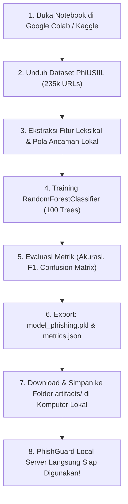

# PhishGuard Cloud Training Pipeline (MLOps Decoupled Architecture)

> **Important Principle:** Sesuai standar arsitektur *Production Machine Learning* & *Edge Inference*, proses training model **TIDAK PERNAH dilakukan di komputer lokal**. Komputer lokal murni berfungsi sebagai *Inference Engine* yang cepat (<30ms), aman, dan hemat daya.

---

## Mengapa Training Dilakukan di Cloud (Google Colab / Kaggle)?

1. **Efisiensi Komputasi:**
   Dataset phishing (seperti *PhiUSIIL URL Corpus*) berisi **235.000+ baris data**. Melakukan ekstraksi fitur leksikal dan melatih *Ensemble Random Forest (100 Decision Trees)* membutuhkan memori RAM besar dan multi-core vCPU yang intensif.
2. **Perlindungan Hardware Lokal:**
   Mencegah laptop/komputer lokal mengalami *overheating*, *memory freeze* (out-of-memory), atau baterai cepat aus.
3. **Reproducibility & Kredibilitas PKM:**
   Juri PKM / Reviewer sangat mengapresiasi pemisahan antara lingkungan riset/pelatihan (*Cloud Training*) dan lingkungan penyebaran (*Local Air-Gapped Deployment*).
4. **Zero-Cost High-Performance Compute:**
   Memanfaatkan infrastruktur komputasi gratis dari Google Colab (hingga 12 GB RAM & High-speed vCPU) atau Kaggle Notebooks.

---

## Alur Kerja Pelatihan (*Cloud-to-Local Workflow*)



---

## Cara Menjalankan Pelatihan di Kaggle Notebook (Sangat Direkomendasikan)

1. **Buka Kaggle:** Masuk ke akun Anda di [Kaggle](https://www.kaggle.com/) lalu klik **Create &rarr; New Notebook**.
2. **Upload Notebook:** 
   * Klik menu **File &rarr; Import Notebook** (atau klik simbol Upload).
   * Pilih berkas `training/PhishGuard_Model_Training_Kaggle.ipynb` dari komputer Anda.
3. **Pilih Akselerator:**
   * Di panel kanan (Notebook Options), set **Accelerator** ke **None** (CPU cukup cepat) atau **GPU T4** jika ingin super cepat.
   * Pastikan **Internet** disetel ke **On**.
4. **Jalankan Pelatihan (*Run All*):**
   * Klik tombol **Run All** (▶▶).
   * Notebook akan otomatis mengunduh dataset PhiUSIIL (235.000 URL), mengekstrak 15 dimensi fitur lengkap secara paralel multi-core, melatih `RandomForestClassifier (100 Trees)`, serta menampilkan plot *Confusion Matrix* dan *Feature Importances*.
5. **Unduh Hasil Artefak (Output Tab):**
   * Setelah selesai, lihat panel kanan di bawah tab **Output (`/kaggle/working/`)**.
   * Klik simbol titik tiga (⋮) atau klik tombol **Download** pada berkas:
     * `model_phishing.pkl` &rarr; simpan di folder `artifacts/model/model_phishing.pkl`
     * `metrics.json` &rarr; simpan di folder `artifacts/evaluation/metrics.json`
6. **Jalankan Server Lokal:**
   ```powershell
   python -m uvicorn app.main:app --app-dir backend --env-file .env --host 127.0.0.1 --port 8000
   ```
   Aplikasi lokal Anda langsung otomatis membaca model 15-fitur tersebut!

---

## Cara Menjalankan Pelatihan di Google Colab

1. **Upload Notebook:** Buka [Google Colab](https://colab.research.google.com/) dan unggah berkas `PhishGuard_Model_Training_Colab.ipynb` dari folder `training/` ini.
2. **Jalankan Seluruh Sel (*Run All*):**
   * Notebook akan otomatis mengunduh dataset PhiUSIIL resmi dari UCI Machine Learning Repository.
   * Menjalankan ekstraksi 11 dimensi fitur leksikal dan fitur lanjutan.
   * Melatih model *RandomForest* dengan pembagian data *Stratified Host-Grouped Split (70% Train, 15% Validation, 15% Test)*.
3. **Unduh Artefak Model:**
   Di sel terakhir notebook, berkas berikut akan otomatis diunduh ke browser Anda:
   * `model_phishing.pkl` &rarr; pindahkan ke `artifacts/model/model_phishing.pkl`
   * `metrics.json` &rarr; pindahkan ke `artifacts/evaluation/metrics.json`
4. **Jalankan Server Lokal:**
   ```powershell
   python -m uvicorn app.main:app --app-dir backend --env-file .env --host 127.0.0.1 --port 8000
   ```
   Server PhishGuard di laptop Anda langsung memuat model terlatih tanpa menggunakan 1% pun beban training lokal.
